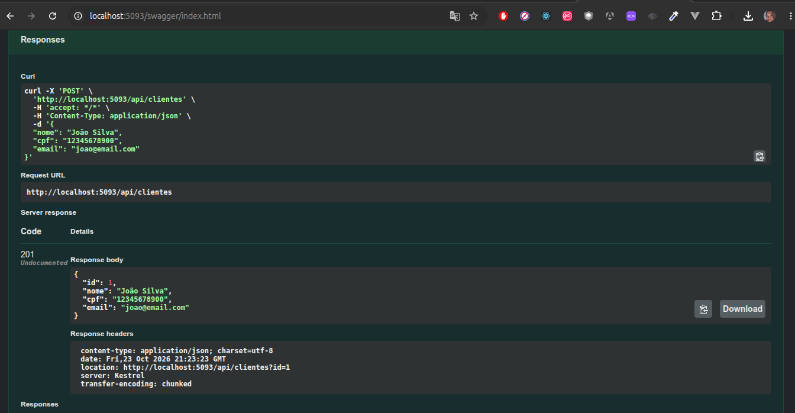
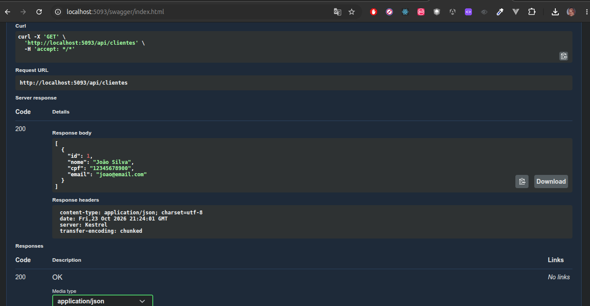
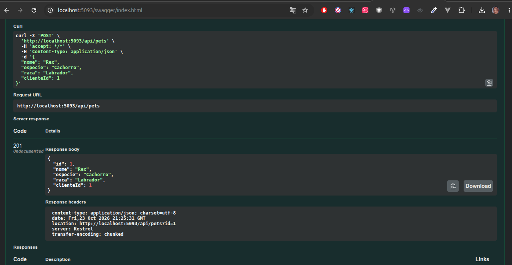
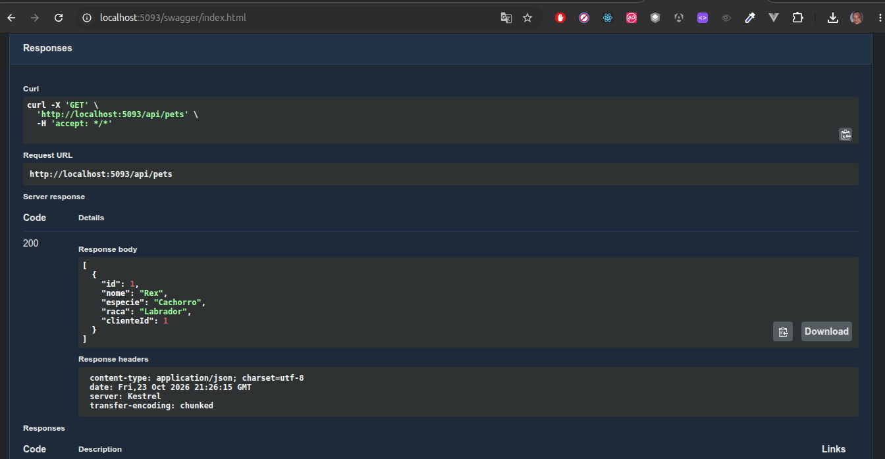
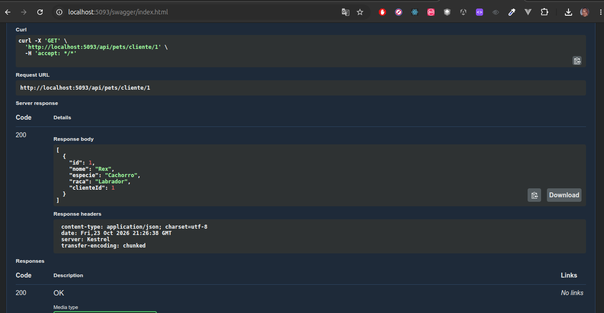

# LH-Pets — Web API

## Sobre o projeto

A LH-Pets é uma Web API desenvolvida em C# com ASP.NET Core, utilizando a arquitetura baseada em Controllers para gerenciar clientes e seus respectivos animais de estimação.

O projeto foi desenvolvido como atividade acadêmica para praticar a criação de APIs REST, orientação a objetos, manipulação de coleções e testes com Swagger.

## Tecnologias utilizadas

- C#
- ASP.NET Core Web API
- Controllers
- Swagger / OpenAPI
- List<T> para armazenamento em memória

## Estrutura do projeto

```
LH-Pets/
├── Controllers/
│   ├── ClientesController.cs
│   └── PetsController.cs
├── Models/
│   ├── Cliente.cs
│   └── Pet.cs
├── Program.cs
├── LH-Pets.csproj
└── README.md
```

## Funcionalidades

### Clientes

- Listar todos os clientes.
- Cadastrar novos clientes.
- Validar campos obrigatórios.

### Pets

- Listar todos os pets cadastrados.
- Cadastrar pets vinculados a clientes existentes.
- Consultar os pets de um cliente específico.
- Validar a existência do cliente informado.

## Endpoints

| Método | Rota                            | Descrição                   |
| ------ | ------------------------------- | --------------------------- |
| GET    | `/api/clientes`                 | Lista os clientes           |
| POST   | `/api/clientes`                 | Cadastra um cliente         |
| GET    | `/api/pets`                     | Lista os pets               |
| POST   | `/api/pets`                     | Cadastra um pet             |
| GET    | `/api/pets/cliente/{clienteId}` | Lista os pets de um cliente |

## Como executar

1. Instale o SDK do .NET.
2. Clone este repositório.
3. Acesse a pasta do projeto.
4. Execute `dotnet restore`.
5. Execute `dotnet run`.
6. Abra o endereço local indicado no terminal e acesse `/swagger`.

## Armazenamento

Os dados são armazenados em coleções `List<T>` na memória da aplicação. Portanto, não há persistência em banco de dados e os cadastros são perdidos quando a aplicação é reiniciada.

## Testes

Os endpoints podem ser testados interativamente pela interface Swagger, permitindo verificar as respostas da API e a associação entre clientes e pets.

### - Captura de Tela

#### Clientes

POST (Cadastrar um Cliente)


GET (Buscar todos Clientes)


#### Pets

POST (Cadastrar um Pet)


GET (Buscar todos Pets)


GET ID (Lista os pets de um cliente)


## Autor

Projeto acadêmico — Desenvolvimento de Web API em ASP.NET Core MVC.

_Mateus Oliveira_
