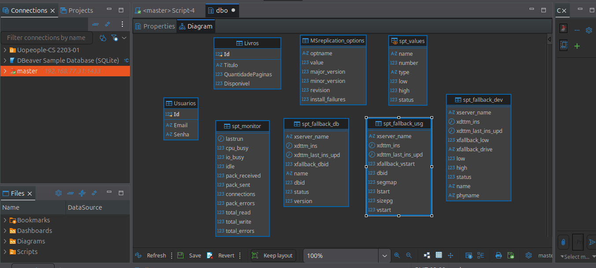
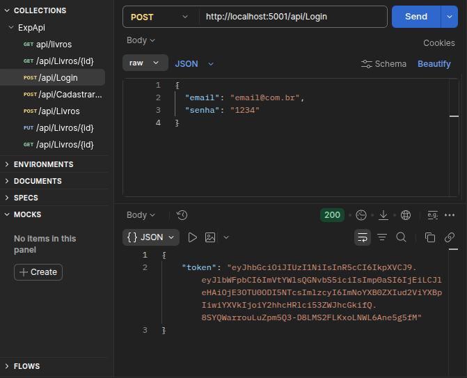
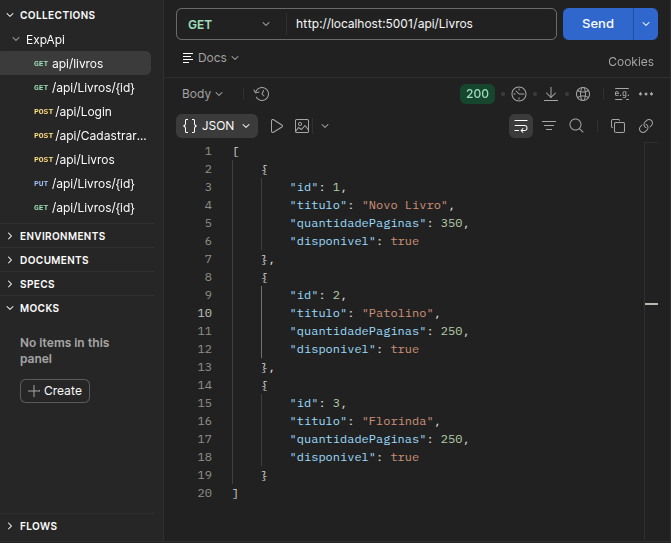
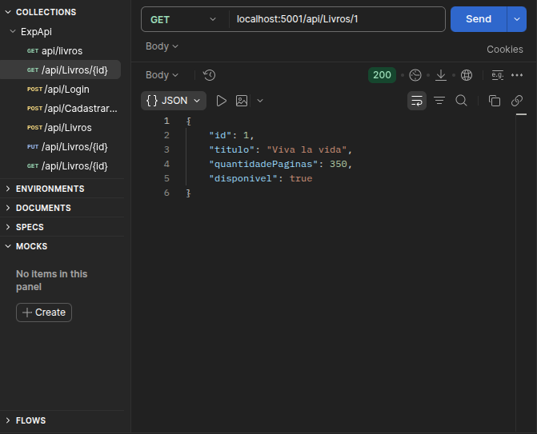
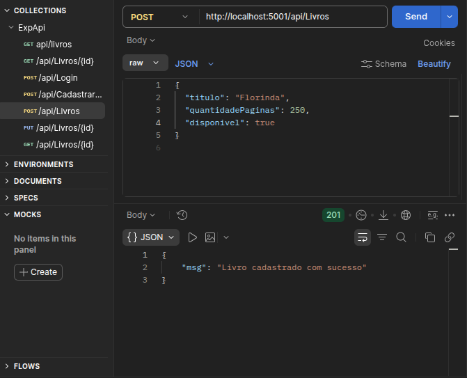
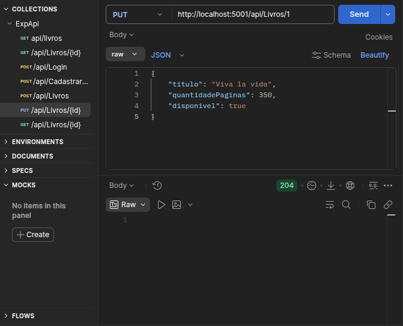
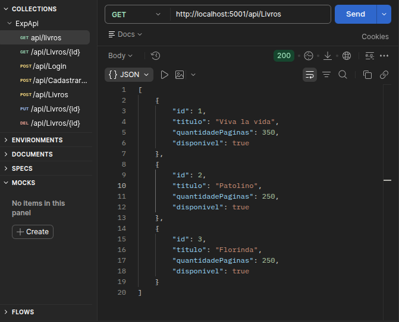
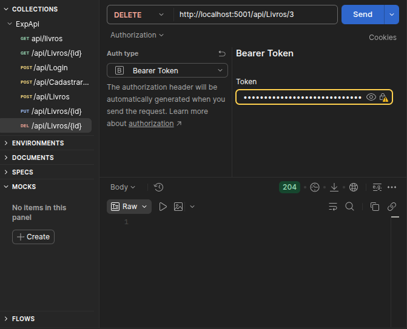
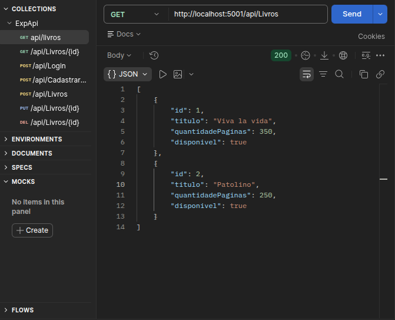

# ExoApi - Chapter

API REST desenvolvida em ASP.NET Core 6 para gerenciamento de livros, com autenticação JWT.

## Tecnologias

- ASP.NET Core 11
- Entity Framework Core
- SQL Server
- JWT (JSON Web Token)
- Swagger / OpenAPI

## Pré-requisitos

- .NET 6 SDK
- SQL Server (Express ou Developer)
- SSMS ou Azure Data Studio

## Configuração do Banco de Dados

1. Abra o SSMS ou Azure Data Studio
2. Execute o arquivo `db.sql` para criar o banco **Chapter** e as tabelas
3. Verifique a connection string em `appsettings.json` se necessário

## DB Diarrama DBeaver



## Diretório

```
ExoApi/
├── Controllers/
│   ├── LoginController.cs
│   └── LivrosController.cs
│   └── CadastrarUsuariosController.cs
├── Models/
│   ├── Livro.cs
│   └── Usuario.cs
├── Interfaces/
│   ├── ILivroRepository.cs
│   └── IUsuarioRepository.cs
├── Repositories/
│   ├── LivroRepository.cs
│   └── UsuarioRepository.cs
├── Contexts/
│   └── ChapterContext.cs
├── ViewModels/
│   └── LoginViewModel.cs
│   └── CadastrarUsuarioViewModel.cs
├── appsettings.json
├── Program.cs
└── ExoApi.csproj

```

## Como rodar

```bash
dotnet restore
dotnet run
```

Acesse o Swagger: `https://localhost:xxxx/swagger` (a porta aparece no terminal)

## Usuário de teste

- **Email:** email@sp.br
- **Senha:** 1234

## Endpoints

### Login

| Método | Rota       | Autenticação | Descrição                   |
| ------ | ---------- | ------------ | --------------------------- |
| POST   | /api/Login | Não          | Realiza login e retorna JWT |

**Body exemplo:**

```json
{
  "email": "email@com.br",
  "senha": "1234"
}
```

### Livros

| Método | Rota             | Autenticação | Descrição              | Status de sucesso |
| ------ | ---------------- | ------------ | ---------------------- | ----------------- |
| GET    | /api/Livros      | Não          | Lista todos os livros  | 200               |
| GET    | /api/Livros/{id} | Não          | Busca livro por Id     | 200 / 404         |
| POST   | /api/Livros      | Não          | Cadastra um novo livro | 201               |
| PUT    | /api/Livros/{id} | Não          | Atualiza um livro      | 204 / 404         |
| DELETE | /api/Livros/{id} | **Sim**      | Remove um livro        | 204 / 404         |

### Exemplo de body para POST/PUT de Livro

```json
{
  "titulo": "Novo Livro",
  "quantidadePaginas": 350,
  "disponivel": true
}
```

## Arquitetura

O projeto segue arquitetura em camadas:

- **Controllers** → Recebem as requisições HTTP
- **Interfaces** → Contratos dos repositórios
- **Repositories** → Acesso aos dados (EF Core)
- **Models** → Entidades do domínio
- **Contexts** → DbContext do Entity Framework
- **ViewModels** → DTOs de entrada (Login)

## captura de tela

### Login

- POST /api/Login



### Livros

- GET /api/Livros



- GET /api/Livros/{id}



- POST /api/Livros



- PUT /api/Livros/{id}





- DELETE /api/Livros/{id}





## Observações

- O endpoint **DELETE** exige autenticação (Bearer Token)
- Após o login, copie o token e clique em **Authorize** no Swagger
- Digite: `Bearer {seu_token}`
