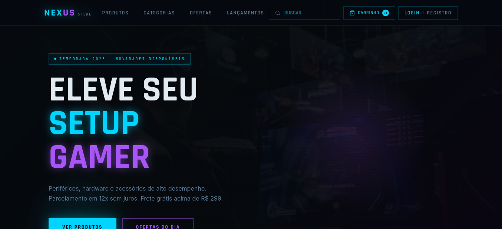
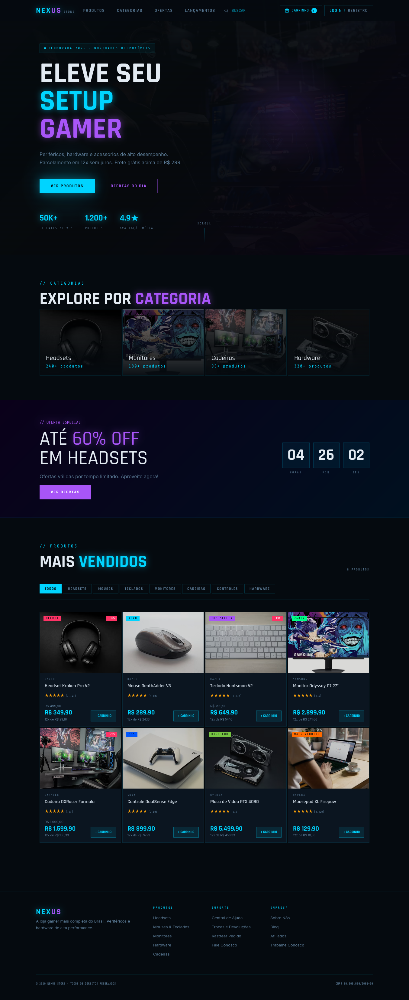
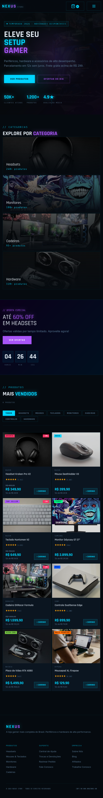
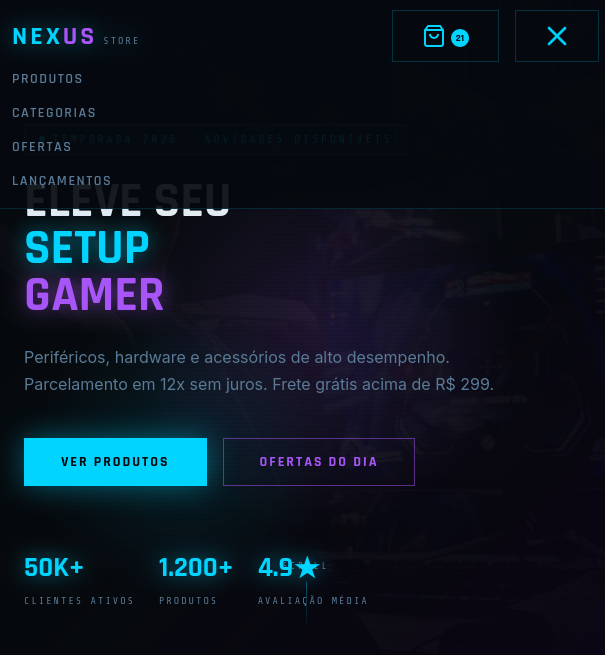
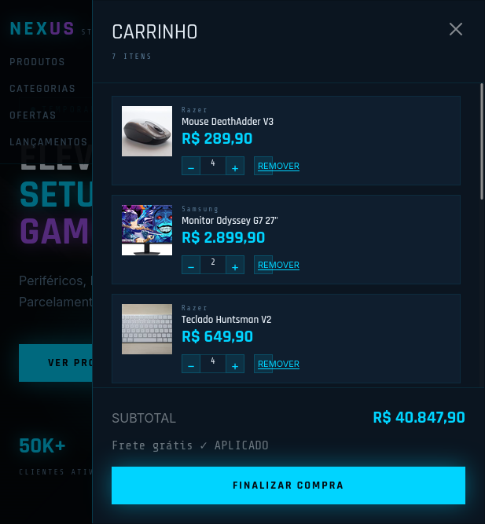
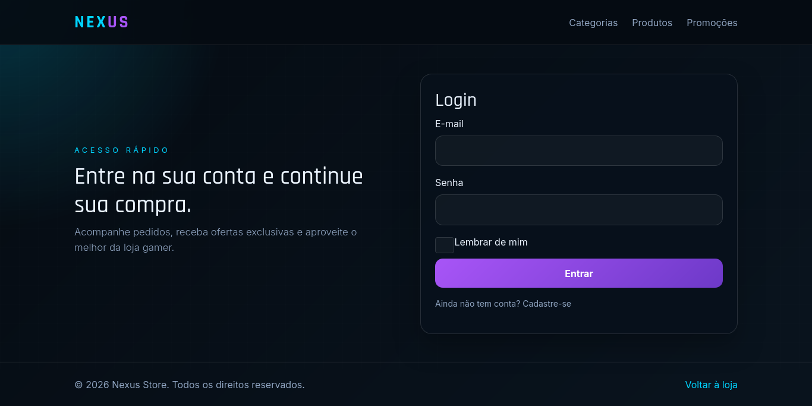
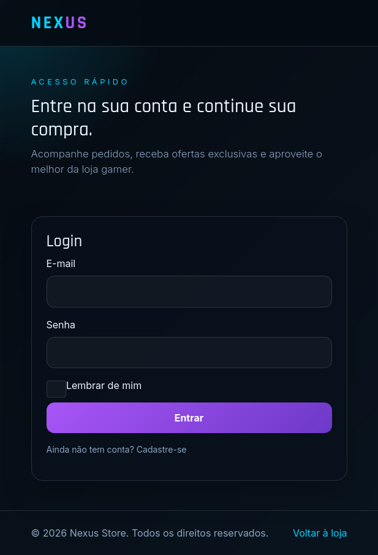
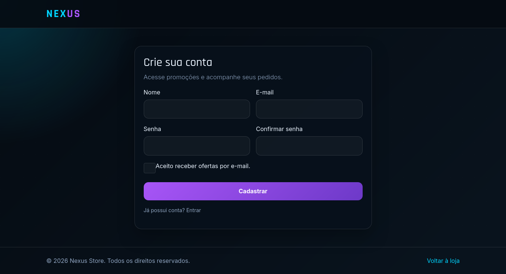
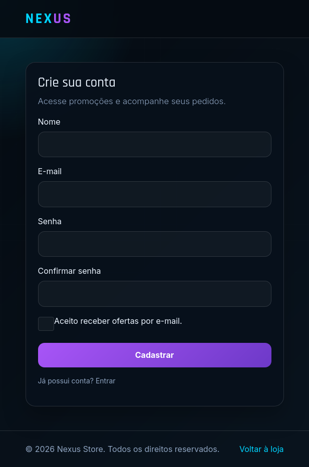
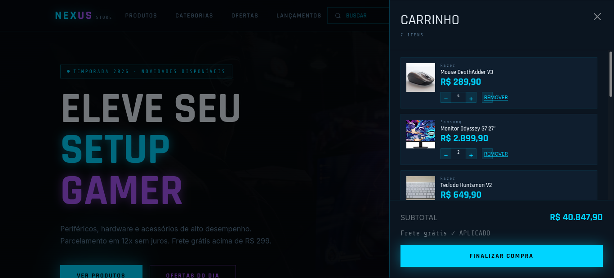

# 🎮 NEXUS STORE

E-commerce de eletrônicos e acessórios voltado ao universo gamer.

## 📸 Preview



## 🛒 Sobre o Projeto

O **NEXUS STORE** é um projeto Front-End de uma loja virtual gamer, desenvolvido com uma interface futurista inspirada em tecnologia e estética cyberpunk.

O site apresenta produtos como:

- Headsets
- Mouses
- Teclados
- Monitores
- Hardware
- Cadeiras gamer
- Acessórios

## 🚀 Funcionalidades

- Página inicial com menu, banner, categorias e produtos
- Página de login
- Busca e filtro por categoria
- Carrinho de compras
- Adição, remoção e alteração da quantidade de produtos
- Cálculo de subtotal e frete grátis
- Persistência do carrinho utilizando `localStorage`
- Layout responsivo para desktop, tablet e mobile
- Menu mobile com Bootstrap
- Interações utilizando JavaScript e jQuery

## 🧰 Tecnologias

- **HTML5** — Estrutura semântica
- **CSS3** — Estilização, animações e responsividade
- **Bootstrap 5** — Grid e componentes responsivos
- **JavaScript** — Lógica e funcionalidades
- **jQuery** — Manipulação do DOM e eventos
- **Git/GitHub** — Versionamento do projeto

## 📂 Estrutura

```text
NEXUS-STORE/
├── index.html
├── login.html
├── register.html
├── css/
│   └── style.css
│   └── style2.css
├── js/
│   └── app.js
│   └── main.js
├── assets/
│   └── icons/
│   └── img/
└── screenshots/
```

📸 Capturas de Tela
Página Inicial


Desktop


Mobile




Página de Login



Página de Register




Carrinho


## 🎓 Conhecimentos Aplicados

O projeto aplica conhecimentos de:

- HTML5 e código semântico
- CSS3 e Media Queries
- Responsividade com Bootstrap
- JavaScript e jQuery
- Manipulação do DOM
- Eventos e interatividade
- Funções, variáveis e estruturas condicionais
- Manipulação de dados
- Armazenamento local com localStorage
- Versionamento com Git e GitHub

## ▶️ Como Executar

Clone o repositório:

```bash
git clone https://github.com/SEU-USUARIO/NOME-DO-REPOSITORIO.git
```

Depois, abra o arquivo index.html no navegador ou utilize o Live Server no Visual Studio Code.

## 🌐 Projeto

🔗 Acesse o repositório no GitHub

## 👨‍💻 Autor

Mateus Oliveira

Projeto desenvolvido para fins acadêmicos.
